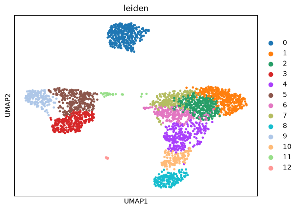
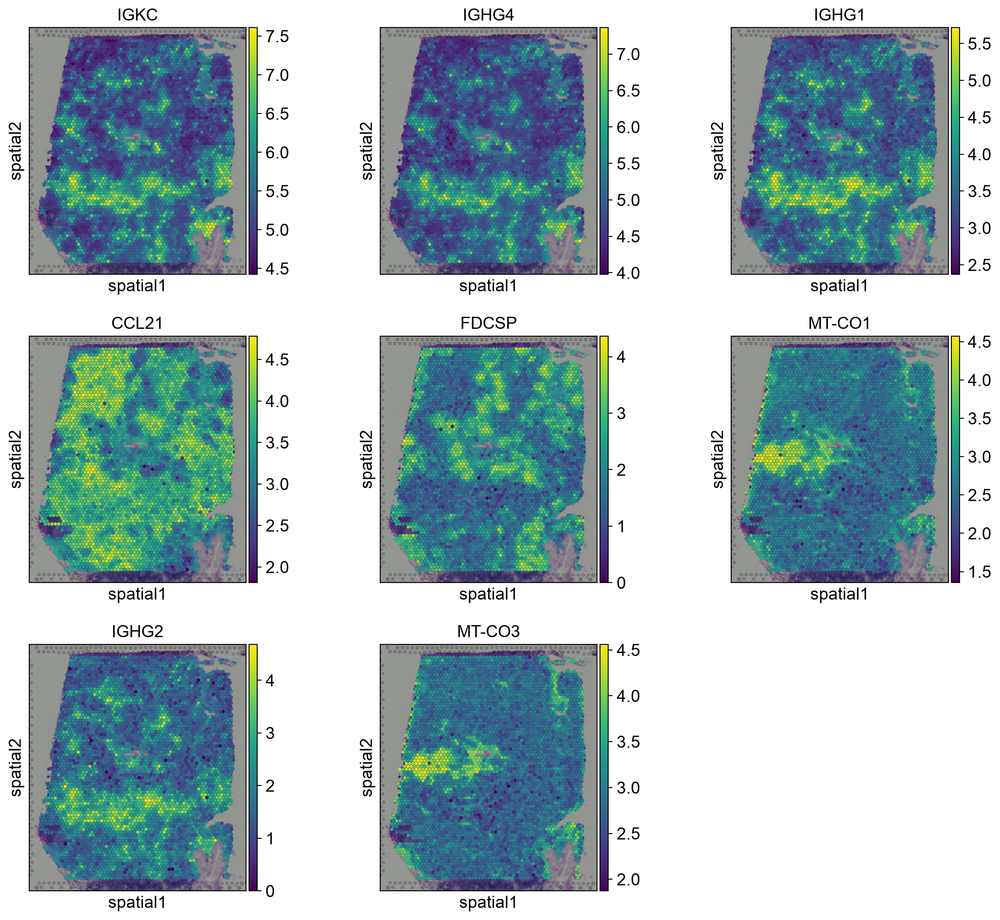
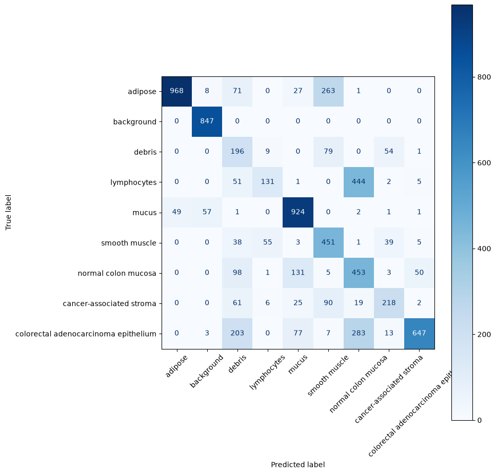

# From Cells to Context: Single-Cell Immune Profiling → Spatial Tissue Mapping → CNN Tissue Classification

## Project Summary

This project explores immune cell biology across single-cell transcriptomics, spatial transcriptomics, and tissue image classification. My goal was to learn from the ground up, how the three subprojects can cell type and classify using different data types. The single-cell portion explored scRNA-seq data, the spatial transcriptomics asked the question, "where do they live in tissue?" (10x Visium dataset), and the histology dataset asked, "can tissue structure be recognized from image morphology alone?". 

My motivation for developing this project was to advance my technical skills in preparation for a data science internship at Element Biosciences. I've been expanding my toolkit to meet the desired skillset of the informatics team, which I was able to gain some insight about from a current member on the team. I wanted to design a cohesive 3-part project to interact with spatial data, 10x data, cell typing, spatial data objects, and CNNs, as they were mentioned to be relevant to the team's work.

## Goals

- Build working analysis pipelines in each area with a cohesive story, rather than 3 unrelated repos. 
- Demonstrate that the same analytical logic (QC, normalization, dimensionality reduction, clustering) applies across modalities, with adaptations at each step.
- Embed my observations and understanding throughout the notebooks, to demonstrate my deep understanding of the analysis. 

## Pipeline

1. **[PBMC Single-cell RNA-seq Analysis](https://github.com/yukarachel/sc-RNA-seq-PBMC-3k)**: QC, normalization, PCA, UMAP, Leiden clustering, marker-gene-based cell-type annotation, logistic regression classifier. Establishes cell-type identity from transcription alone, with no spatial context.

2. **[`02_spatial_transcriptomics/`](./02_spatial_transcriptomics/)**: 10x Visium spatial transcriptomics on human lymph node tissue. Same core analytical logic as the PBMC project (QC, normalization, clustering), extended to data where each unit is a multi-cell Visium spot with a physical (x, y) tissue location. Tests whether transcriptional clustering corresponds to real spatial tissue organization, and finds marker genes that represent distinct immune cell populations occupying specific physical locations within the tissue.

3. **[`03_tissue_cnn/`](./03_tissue_cnn/)**: A PyTorch CNN classifying tissue image patches by morphology, independent of any RNA measurement. Main question: If spatial transcriptomics shows gene expression organizes into physical tissue structure, can that same structure eventually be recognized directly from how tissue *looks*, without sequencing at all?

## Conclusions

**PBMC single-cell analysis:**
- Used PCA to find first 10 principal components that informed Leiden clustering
- Clustered into 9 biologically meaningful classes (12 classes condensed to 9) of immune cell types (B-cell, T-cell, etc.)
- Trained on 3 linear classifiers (logistic regression via scikit-learn) and 1 non-linear classifier (random forest via scikit-learn), and compared performance. Highest performance was 99% by logistic regression using 10 principal components as features 
- Fine tuned hyperparameters (number of principal components) for logistic regression model
- Found marker genes for each cell type using 2 independent methods (Scanpy's rank_gene_groups(), and top coefficients (genes) of logistic regression model)

**Spatial transcriptomics of lymph node tissue:**
- Loaded a public 10x Visium human lymph node dataset (4,035 spots × 36,601 genes). QC thresholds were chosen via a sorted count knee plot rather than arbitrary/default cutoffs, retaining 3,995 spots. Mitochondrial content was uniformly low across the tissue, so no separate mito filter was needed
- Standard normalization, HVG selection, PCA, and Leiden clustering (resolution=1.0) produced 9 transcriptionally distinct clusters
- Clusters were **not randomly scattered** when overlaid on the tissue image. They formed spatially coherent, patch-like regions consistent with known lymph node anatomy (ex. germinal centers, T-cell zones). Transcriptional identity and physical tissue organization are not independent, they correspond
- Moran's I spatial autocorrelation, run independently of cluster labels, identified genes with strong spatial structure. A substantial fraction of these genes (36 of the top cluster-defining markers) also appeared among the top spatially autocorrelated genes
- Two independent methods produced overlapping genes, strengthening confidence that both are detecting real biological organization rather than noise.
- This contrasts with the PBMC project: dissociated single-cell data can identify *what* cell types exist, but destroys any record of physical organization. Spatial transcriptomics preserves the information scRNA-seq loses

**Classifying cell types on morphology alone:**
- Built a 2-convolution layer PyTorch CNN to classify tissue image patches by morphology and no transcriptional data 
- "The PathMNIST is based on a prior study for predicting survival from colorectal cancer histology slides, providing a dataset (NCT-CRC-HE-100K) of 100,000 non-overlapping image patches from hematoxylin & eosin stained histological images, and a test dataset (CRC-VAL-HE-7K) of 7,180 image patches from a different clinical center. The dataset is comprised of 9 types of tissues, resulting in a multi-class classification task." 
- Evaluated with a proper train/val/test split and confusion matrix, with honest discussion of where the model made mistakes
- Cancer detection (colorectal adenocarcinoma epithelium): high precision (91%) but low recall (52%). The model flags cancer, and it's usually right, but it misses nearly half of true cancer cases (false negatives), the more clinically concerning failure
- Lymphocytes were poorly classified by morphology alone (21% recall), despite being clearly identifiable via gene markers (CD3E, CD19) in the spatial transcriptomics subproject. Multimodal approaches (combining RNA expression and imaging) likely could outperform either alone
- Debris had the lowest precision (27%). The model over-predicts this class broadly, a different failure pattern (over-flagging) than the cancer under-flagging.

